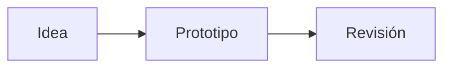

# Trazo

Una aplicación de dibujo con el editor real de Excalidraw, tableros locales y plantillas. La interfaz está en español y conserva el lienzo, las herramientas, los atajos, las notas adhesivas y la biblioteca del editor.

## Arrancar

Requisitos: Node.js 24 LTS y npm. Las dependencias ya están instaladas en este equipo.

```sh
cd /Users/pablosuarezpena/Documents/ChatGPT/Excalidraw
npm run dev
```

Abrir **[http://127.0.0.1:5173/](http://127.0.0.1:5173/)**. Para detener el servidor, pulsar `Ctrl+C` en su terminal. Si el puerto ya está ocupado por Trazo, abrir esa dirección o detener el servidor anterior antes de arrancar otro.

Para una instalación nueva:

```sh
npm ci
npm run dev
```

## Uso

- **Tableros** abre la lista, con búsqueda y vistas previas. El menú de cada tablero permite cambiar el nombre, duplicarlo o eliminarlo.
- El nombre de la barra superior se puede editar directamente.
- **Nuevo** permite elegir un lienzo en blanco, un diagrama de flujo, un tablero de tareas o una lluvia de ideas.
- El guardado es automático. Antes de cambiar de tablero se espera a que terminen las escrituras pendientes.
- **Exportar** descarga un archivo editable `.excalidraw`, una imagen PNG o un SVG. El archivo editable incluye las imágenes utilizadas.
- **Importar** valida el archivo y lo abre como un tablero nuevo. El tablero que estaba abierto se conserva.
- La biblioteca se comparte entre los tableros de este navegador. El tema claro u oscuro también se recuerda.

## Convertir Mermaid y Markdown

Pulsa **Convertir** en la barra superior, o **Convertir Mermaid o Markdown…** en el menú del lienzo.

1. Pega contenido o pulsa **Cargar archivo** para abrir un `.mmd`, `.mermaid`, `.md`, `.markdown` o `.txt`.
2. Pulsa **Convertir a lienzo** y revisa la vista previa. Puedes ajustar el nombre del tablero.
3. Pulsa **Crear tablero** para guardar el resultado como un tablero independiente.

Los archivos Markdown conservan el orden de sus títulos, texto, código y bloques de diagramas. El texto se transforma en tarjetas editables; los diagramas se extraen de bloques de código con lenguaje `mermaid` o `mmd`. Los enlaces y las referencias a imágenes del Markdown se conservan como texto. El resultado es texto plano editable, con títulos y bloques de código, y no reproduce todo el formato visual de Markdown.

Ejemplo:

````markdown
# Mi proyecto

- Preparar el prototipo
- Revisar los resultados


````

Los tipos de Mermaid compatibles con formas generan elementos editables. Otros tipos se insertan como imágenes; la vista previa indica cuándo sucede. Las imágenes generadas se incluyen en el guardado y en los archivos `.excalidraw`.

El formato se detecta automáticamente, con prioridad a la extensión del archivo. El selector **Formato** permite elegir Mermaid o Markdown de forma explícita. Los límites son 1 MB por archivo, 100.000 caracteres, 12 diagramas y 120 secciones por documento. Un error de sintaxis conserva el contenido en el diálogo y permite corregirlo antes de crear el tablero.

Las conversiones usan `@excalidraw/mermaid-to-excalidraw@3.6.0`, que ya estaba incluido como dependencia del editor y ahora se declara directamente. Su carga se hace al convertir. [API oficial](https://plus.excalidraw.com/docs/mermaid-to-excalidraw/api).

Los datos se guardan en IndexedDB, asociados al navegador y a la dirección usada para abrir la aplicación. Utilizar siempre `127.0.0.1:5173` permite volver al mismo espacio. Las copias descargadas permiten trasladar un tablero a otro navegador o equipo.

Si falla el guardado, se muestra un aviso con las acciones de reintentar y descargar una copia. Una escritura desde una pestaña desactualizada se rechaza para conservar la versión guardada por la otra pestaña. En ese caso, descargar la copia del dibujo abierto y recargar la página.

## MCP local — servidor y herramientas

El servidor utiliza el mismo patrón HTTP de Mochi y Resizes.ai: `/mcp` y `/mcp/`, clave en `Authorization: Bearer`, protocolo sin sesiones y claves revocables. Las ocho herramientas trabajan sobre los tableros reales del navegador vinculado. El botón **MCP** de la barra superior permite vincular y desconectar el lienzo. El panel con configuraciones copiables para Cursor, Claude Code y Codex llegará en la tercera fase.

Requiere Node.js 24. El servidor escucha únicamente en `127.0.0.1:5174`, independientemente del editor en el puerto 5173. Para activarlo en otra terminal:

```sh
MCP_ENABLED=true npm run mcp
```

También puedes copiar `.env.example` a `.env` y cambiar `MCP_ENABLED` a `true`. Cualquier otro valor deja `/mcp/` desactivado (404). `TRAZO_MCP_PORT` permite elegir otro puerto si el 5174 está ocupado.

Crear una clave para cada cliente:

```sh
npm run mcp:keys -- create --name "Cursor" --days 30
npm run mcp:keys -- list
npm run mcp:keys -- revoke --id IDENTIFICADOR
```

La creación devuelve el secreto una sola vez. `list` muestra identificadores y metadatos; no permite recuperar el secreto. Cada clave dura de 1 a 365 días y hay un límite de 20 claves activas. La revocación se aplica a la siguiente solicitud, sin reiniciar el servidor. El acceso a la terminal y a la carpeta privada del usuario administra las claves; el servidor HTTP no expone una ruta pública para crearlas.

### Vincular el navegador

Con Trazo abierto y el servidor MCP activado, genera un código desde otra terminal:

```sh
npm run mcp:keys -- pair
```

Pulsa **MCP** en la barra superior, pega el campo `code` en **Código de vinculación** y pulsa **Vincular navegador**. Si elegiste otro puerto, ajusta **Servidor local**. El código se consume una sola vez y caduca a los diez minutos. Autoriza el acceso a todos los tableros de ese espacio local. Los clientes que tengan una clave API válida podrán trabajar sobre ellos mientras esté conectado.

El código de vinculación y las claves API cumplen funciones distintas. El navegador obtiene una credencial propia; una clave de una IA no puede hacerse pasar por el editor. El servidor conserva solo hashes de los códigos y de las credenciales del enlace. La credencial del navegador se conserva en `sessionStorage` de esa pestaña, dura ocho horas y permite reconectar tras una recarga. La reconexión puede tardar 15 segundos al liberar la reserva de la pestaña anterior. Si el servidor se reinicia, genera otro código y vuelve a vincular.

Mantén la pestaña abierta. Se admite un navegador vinculado y una pestaña ejecutora a la vez. **Desconectar este navegador** corta el enlace, sin eliminar tableros ni revocar las claves de los clientes. Si cierras Trazo, las herramientas devuelven un error de conexión en lugar de anunciar cambios guardados.

### Herramientas

- `list_boards`: lista y busca tableros; devuelve el identificador del tablero abierto.
- `get_board`: devuelve la escena editable como JSON y su revisión. `includeFiles: true` incluye los datos de imágenes.
- `create_board`: crea y abre un tablero con una plantilla (`blank`, `flow`, `kanban`, `notes`) o una escena Excalidraw completa.
- `update_board`: sustituye la escena con `boardId`, `expectedRevision` y `scene`. Conserva los archivos de imagen existentes si no se envían y permite deshacer el cambio desde el editor.
- `rename_board` y `delete_board`: requieren `boardId` y `expectedRevision`. El borrado es permanente.
- `convert_document`: convierte `content` con formato `auto`, `mermaid` o `markdown` en un tablero nuevo. Devuelve los recuentos de bloques, elementos y diagramas insertados como imágenes.
- `export_board`: devuelve el archivo `.excalidraw`, un recurso SVG o una imagen PNG mediante MCP; no inicia una descarga en el navegador.

Antes de cada operación se guarda el dibujo pendiente. Obtén `expectedRevision` con `get_board`; una versión antigua rechaza el cambio sin sobrescribir el dibujo. Las escrituras se confirman después de guardarlas en IndexedDB. Los comandos se ejecutan en orden y no se reenvían automáticamente. Si se pierde la confirmación de una operación iniciada, el error indica que el cambio puede haberse aplicado: consulta el tablero antes de repetirlo.

El límite es de 20 comandos en espera, 90 segundos por comando, 5000 elementos por escena y 8 MB por archivo exportado o escena leída. Las peticiones MCP siguen limitadas a 1 MB. El canal privado de respuestas del navegador admite hasta 16 MB para devolver archivos codificados. Los tableros y sus imágenes permanecen en IndexedDB; el servidor mantiene los comandos en memoria mientras se ejecutan.

Las claves se guardan como SHA-256 de un secreto aleatorio de 256 bits en `keys.sqlite`. En macOS, la carpeta predeterminada es `~/Library/Application Support/Trazo/mcp/`; en otros sistemas se utiliza `$XDG_DATA_HOME/Trazo/mcp/` o `~/.local/share/Trazo/mcp/`. `TRAZO_MCP_DATA_DIR` permite cambiarla, tanto al arrancar como al gestionar claves. La carpeta debe tener permisos 700 y el archivo 600. No se admiten enlaces simbólicos para la carpeta final ni el archivo. Las claves no se guardan en los tableros ni en el repositorio.

La URL para los clientes es `http://127.0.0.1:5174/mcp/`. Envía la clave como `Authorization: Bearer trazo_…`. El servidor ignora cookies de sesión, valida `Host` y `Origin`, limita los mensajes a 1 MB y bloquea durante el resto de la ventana de un minuto tras cinco intentos fallidos. Solo permite los orígenes locales de Trazo en los puertos 5173 y 4173, además de su propio origen. Las configuraciones copiables para cada IA se añadirán con el panel.

El transporte responde con JSON y admite las versiones `2025-03-26` y `2025-06-18`. Una versión de inicialización desconocida negocia `2025-06-18`; una cabecera `MCP-Protocol-Version` no admitida se rechaza. Las notificaciones devuelven 202 sin cuerpo, `GET` devuelve 405 porque no se ofrecen eventos SSE y `DELETE` autenticado es una operación vacía. No acepta lotes JSON-RPC. [Especificación del transporte MCP](https://modelcontextprotocol.io/specification/2025-06-18/basic/transports).

`npm run test:mcp` comprueba el servidor con solicitudes HTTP reales y el SDK oficial de MCP, además de caducidad, revocación, persistencia, permisos y gestión de claves por terminal. Las pruebas crean sus propias carpetas y claves temporales.

## Comprobar y compilar

```sh
npm test
npm run build
npm run preview
```

`build` comprueba TypeScript y genera `dist/`. `preview` sirve esa compilación en `http://127.0.0.1:4173/`. El puerto de preview tiene su propio almacenamiento del navegador.

Las fuentes se sincronizan desde el paquete oficial a `public/fonts/` antes de arrancar o compilar. Se eliminan las copias sobrantes y se conservan los archivos idénticos. Esa carpeta es generada y no se versiona.

## Estructura

- `src/components/`: editor, selector de plantillas, lista de tableros y diálogos.
- `src/useWorkspace.ts`: carga, cambios de tablero, importación y exportación.
- `src/lib/storage.ts`: transacciones IndexedDB, metadatos y control de versiones.
- `src/lib/save-queue.ts`: escrituras ordenadas, agrupación de cambios y reintentos.
- `src/lib/templates.ts`: escenas editables de las plantillas.
- `src/lib/document-input.ts`: lectura de archivos y separación de texto, código y bloques Mermaid.
- `src/lib/convert-document.ts`: conversión y disposición de los elementos, con sus imágenes.
- `scripts/rea-mcp.mjs`: cliente local MCP usado en la investigación y las comprobaciones de navegador.
- `server/`: servidor MCP local, protocolo, cola del enlace con el navegador y almacenamiento de claves; su entrada es `server/index.mjs`.
- `shared/mcp-contract.ts`: herramientas, esquemas y validación compartidos entre servidor y navegador.
- `src/lib/workspace-tools.ts`: operaciones MCP sobre el repositorio, conversión y exportación del editor.
- `src/lib/mcp-bridge.ts`: vinculación, reserva de la pestaña, recepción de comandos y confirmaciones.
- `scripts/mcp-keys.mjs`: creación, listado y revocación local de claves.

## Versión y alcance

Se utiliza `@excalidraw/excalidraw@0.18.0-2c3dcc0`, fijado en el lockfile. Su revisión declarada coincide con la web analizada en la fase 1. Es una versión previa a estable; la coincidencia no demuestra igualdad binaria con el sitio público.

La aplicación funciona localmente. No incluye cuentas, colaboración entre personas, sincronización entre dispositivos ni servicios de IA. La revisión ampliada de importación/exportación, imágenes, biblioteca y accesibilidad corresponde a la fase 3.

Consulta [el análisis de referencia](docs/reference-analysis.md) y [las comprobaciones de implementación](docs/phase-2-validation.md).

Las pruebas del conversor con las APIs reales del navegador están en [tests/browser/README.md](tests/browser/README.md).

## Dependencias en este equipo

La primera instalación en `Documents` sufrió bloqueos de lectura. Una instalación nueva en `~/Library/Caches/trazo-dev/60108924f3ec/` permitió arrancar, compilar y ejecutar las pruebas. El `node_modules` local está enlazado a esa caché; el enlace no se versiona. No se ha determinado la causa del bloqueo de la primera instalación. En otros equipos basta con `npm ci`.

## Licencias

El editor Excalidraw utiliza licencia MIT; se conserva su aviso en [public/licenses/LICENSE](public/licenses/LICENSE). Ver [THIRD_PARTY_NOTICES.md](THIRD_PARTY_NOTICES.md) para las dependencias principales.
